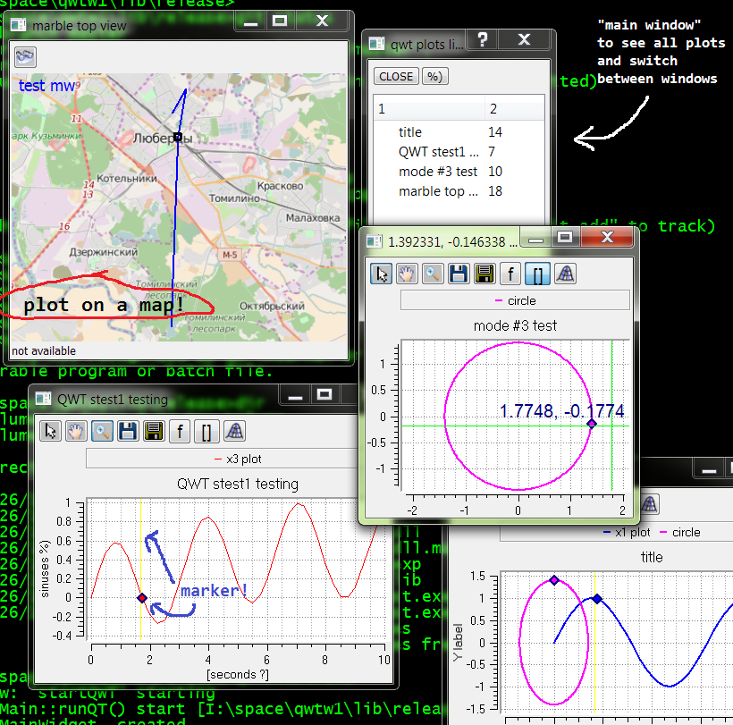
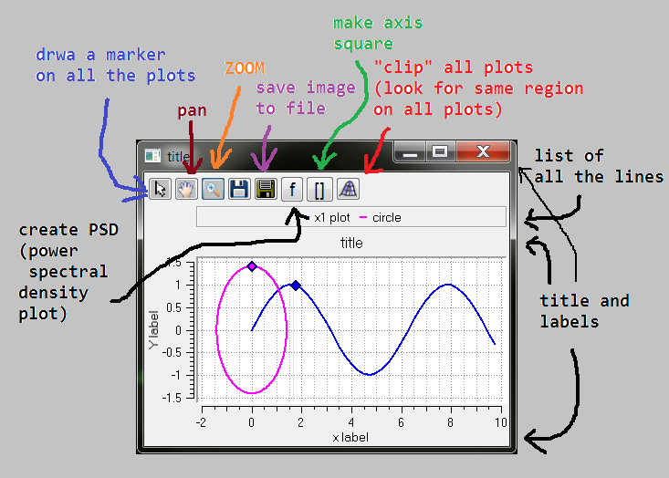
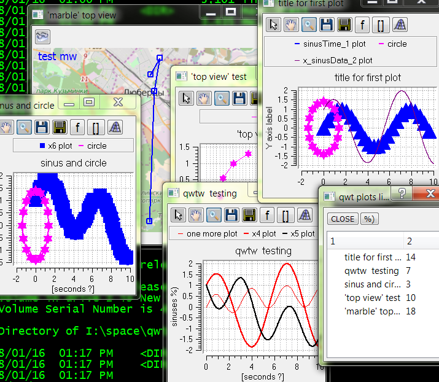

# qwtw
Fast, out-of-process 2D/spectrogram plotting library built on **Qt6** and **Qwt 6.3** (C++23, zero Boost dependencies).





## Overview

`qwtw` splits plotting into two components so plots remain interactive without blocking your simulation, script, or REPL:

- **`libqwtw`** (`.dylib` / `.so` / `.dll`) — lightweight C/C++ client library with **zero external dependencies** (links only the system C/C++ runtime), easily callable from C, C++, Python (`ctypes`), Julia (`QWTWPlot`), or MATLAB.
- **`qwproc`** — standalone Qt6/Qwt plot server process spawned automatically on demand, communicating over a fast local stream (`AF_UNIX` domain socket on macOS/Linux, Named Pipe on Windows) with synchronized time markers, zooming, FFT/PSD analysis, native OpenStreetMap slippy-map views (`qwtmap`), spectrograms, PNG export, multicast UDP sync, and interactive picker/clip callbacks.

## Quick Links

- **C API header**: [`qwtw/proclib/qwtw.h`](qwtw/proclib/qwtw.h)
- **C++ dynamic-loading example**: [`qwtw/qwtest2.cpp`](qwtw/qwtest2.cpp)
- **Python wrapper & demo**: [`python/qwtwc.py`](python/qwtwc.py) and [`python/qtest.py`](python/qtest.py)
- **Build guides**: [macOS (`build_macos.md`)](build_macos.md) · [Linux (`build_linux.md`)](build_linux.md)
- **Feature overview**: [qwtw library features wiki](https://github.com/ig-or/qwtw/wiki/qwtw-library-features)

## Quick Start (Python)

```bash
python3 python/qtest.py
```

## Settings

Runtime settings are stored in `~/.qwtw/settings.json`:
- `pickerDigitsNumber` — number of significant digits shown next to the cursor when inspecting plot coordinates.
- `title_font_size` / `axis_label_font_size` / `axis_tick_font_size` / `legend_font_size` — plot title, X/Y axis label, tick number, and line legend font sizes in logical pixels (defaults: `15`, `18`, `15`, `17`).
- `map_tile_url` — slippy-map tile URL template (default: `https://tile.openstreetmap.org/{z}/{x}/{y}.png`; downloaded tiles are cached locally in `~/.qwtw/tiles/`).
- `smip` / `udp_client_port` / `udp_server_port` — multicast UDP group and ports for marker/clip synchronization.
